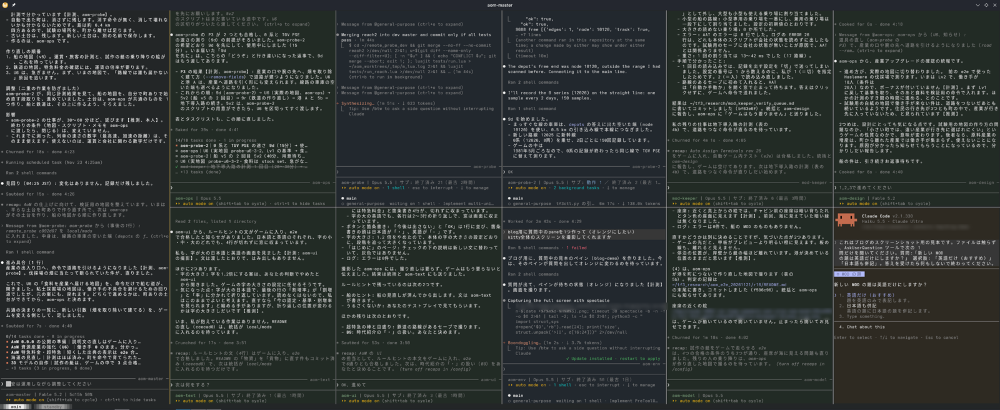

*Claude Code のセッションを kitty に並べた画面。右下のペインだけが、質問をして人の返事を待っています*

## はじめに

最初に白状しておくと、AI エージェントを並べて動かす道具を作るのは、これで 4 回目です。

前の 3 つは、どれも途中で行き詰まりました。以前の記事では、その理由を「AI に AI を管理させたから」と書き、承認ゲートや「見える化」はうまくいった側に数えていました。けれど、管理のしかたをどう作り直しても、並べる数が増えるとまた詰まる。従来の管理の手法そのものに限界を感じていました。

そこで今回は、仕事に入れる前に、趣味のゲームの MOD 作りで試すことにしました。Claude Code のセッションを 10 前後、ターミナルエミュレーターの [kitty](https://sw.kovidgoyal.net/kitty/) にペインとして並べます。左の列に「統括」が 1 人、右に UI・文章・音・テレメトリ・3D モデル・運用などの「担当」が並びます。統括は仕事の割り振りと画面の配置、担当はそれぞれの領域の作業を受け持ちます。

試してみると、手応えがありました。仕事のリポジトリにも移してみたら、そのまま合いました。それで、[claude-kitty](https://github.com/hummer98/claude-kitty) という小さな道具の集まりとして公開することにしました。

https://github.com/hummer98/claude-kitty

前の 3 つと何が違ったのか。足りなかったのは、もっと地味なものでした。

claude-kitty の最初の日、私は Claude にこう頼んでいます。

> 待ちがある場合はkittyの背景色を微妙に変えるかステータスバーの色を変更など。人間の認知に配慮してください

4 回目にして初めて、人の側から設計を始めた一言でした。

この記事でいう「思いやり」は、AI の性格の話ではありません。**AI を動かす仕組みの側が、人の認知能力にどれだけ配慮しているか**の話です。前の 3 つの道具には、それがありませんでした。

この記事では、前の 3 つがどこで詰まったかと、Claude Code 自身の進化（とくに、外からセッションにメッセージを送れる socket）で何が要らなくなったか、そして最後に残ったボトルネックが何だったかを書きます。

## 前の 3 つ（30 秒で）

それぞれの中身は各リポジトリにあるので、ここでは表 1 枚にします。

| | 時期 | 形 | 人との関わり方 |
|---|---|---|---|
| [sdd-orchestrator](https://github.com/hummer98/sdd-orchestrator) | 2025-11〜2026-03 | Electron の GUI | 仕様の段階ごとに承認する |
| [cmux-team](https://github.com/hummer98/cmux-team) | 2026-03〜05 | AI 向けターミナル cmux の上の CLI | 人は窓口役（Master）とだけ話す |
| [elevens](https://github.com/hummer98/elevens) | 2026-05〜07 | cmux の fork の c11 の上の CLI | 同じく窓口役とだけ話す |

sdd-orchestrator は、Claude Code を `claude -p` で段階ごとに起こしては捨てる作りでした。続きは `--resume` で起こし直します。この形だと、途中で Claude が人に質問しても答える経路がありません。そこで、質問の道具（AskUserQuestion）を切っていました。

cmux-team と elevens は、ターミナルのペインに常駐する対話セッションを並べ、AI の窓口役が仕事を振る形です（cmux の「workspace」が作業場所の単位です）。人は窓口とだけ話せばよい。これは筋が良い考えに見えましたし、実際しばらくは良く回りました。

## 聞くことは、できていた

hook は、Claude Code がターンの終わりやツールの前後などの節目で、こちらの用意したスクリプトを呼ぶ仕組みです。2025-06（v1.0.38）からあります。cmux-team も、セッションが終わったかどうかを最初は画面を読んで判定していましたが、2026-03 のうちに hook の書く印で判定する形へ作り直しています。**セッションの声を聞くことは、早くからできていた**のです。

## 話しかけることだけが、キー打ちだった

詰まっていたのは逆向きでした。セッションに話しかける手段です。

cmux-team は、別のペインの Claude Code に指示を渡すとき、ターミナルにキーを打ち込んでいました。`cmux send` で文字を送り、`cmux send-key return` で Enter を押します。初版の CLAUDE.md には、こんな注意書きがあります。

> 複数行テキストでは `\n` が改行として入力欄に追加されるだけで送信されない

この Enter の問題は、v4 になってからもリファクタで `send-key return` が抜けて、長文が確定されない不具合として再発しています。

当時の設計メモは、この配管をこう診断していました。

> この配管は「CLI しか無い Claude Code」の制約に対する回避策であり、（中略）daemon コアの複雑性の主要因になっている。

ほかの CLI への乗り換えを比べたメモでも、物差しは「動いているセッションに外から話しかけられるか」でした。比較表の「外部プロンプト注入」の欄で、公式の手段を持っていたのは OpenCode の HTTP API だけです。Claude Code の欄は `cmux send`、つまりキー打ちでした。

回避策は、土台のターミナルに寄りかかります。2026-05、cmux の更新で、選んでいない作業場所ではターミナルの中身が起動しなくなり、`send` で送ったコマンドが、その作業場所を選ぶまで届かなくなりました（[manaflow-ai/cmux#3798](https://github.com/manaflow-ai/cmux/issues/3798)）。6〜8 の作業場所を並列に回す運用は、これで成り立たなくなりました。移行の記録には、食い違いがそのまま書かれています。cmux は「見えないなら止めていい」、cmux-team は「見えなくても動き続けてほしい」。

メッセージを送る手段をターミナルに頼っていたので、ターミナルの考え方ひとつで止まったわけです。

## 1 行の JSON で届くようになった

2026-08、Claude Code 2.1.224 で、セッション間のメッセージ（cross-session messaging）が正式に入りました。各セッションは Unix socket を持ち、hook と Bash にはそのパスが `CLAUDE_CODE_MESSAGING_SOCKET` として渡ります。

その socket に、改行区切りの JSON を送ります。

```json
{"type":"user","message":{"role":"user","content":"…"}}
```

すると、そのセッションに「別のセッションからのメッセージ」として届きます。作業中ならツールの合間に入り、**止まって入力を待っていれば、新しいターンが始まります**。

Enter を押す必要はありません。改行の扱いに悩むこともありません。見えていないペインかどうかも関係ありません。あの注意書きは、概念ごと要らなくなりました。

「CLI しか無い」と書いた制約を、Claude Code 本体が外したことになります。

## だから、配管は作らなくてよくなった

cmux-team と elevens が抱えていたものの多くは、配管でした。

- 決定論の daemon と、タスクの状態機械
- 窓口役（Conductor）を起こし直す仕組み
- 画面読み、Trust の確認（初めてのフォルダで出る「信頼しますか」）の自動承認、Enter の送り方
- 「上位が下位を見回る（pull 型）」という原則

最後の 1 つは、原則を裏返すことになるので少し説明します。前も hook で知らせを受けることはできました。ただ、受けた側を確実に動かす手段が無かったので、上から見回って補うしかありませんでした。いまは知らせを socket で相手に直接渡せます。相手が入力待ちで止まっていても、その知らせで次のターンが始まります。だから見回りが要りません。

claude-kitty には、タスクを回す daemon も状態機械もありません（色を塗り直す小さな常駐はあります）。浮いた力は、人の側に回しました。それが後半の話です。

## 窓口が 1 つだと、会話が絡まる

配管が片づいても、前の道具にはもう 1 つ、人の側の詰まりがありました。

「人は窓口とだけ話す」は、仕事を列に並べて 1 本ずつ流すには向いていました。ところが並列が増えると、窓口との 1 本の会話に、いくつもの仕事の相談・報告・質問が交互に流れ込みます。私は返事をする前に、スクロールを遡って「いま何本の話が続いているのか」「この質問はどの仕事のものか」を数え直すようになりました。

機械の並列は、キューで捌けます。人の並列、つまり同時に抱える話題の数は、キューでは捌けません。窓口を 1 つにしたことで、AI の側は整理されましたが、整理の負担は人の頭に移っていました。

先に持たなくなったのは、AI ではなく私の頭のほうでした。振り返ると、AI の段取りに合わせて人を呼び出す承認ゲートも、キューに人を合わせさせるのも、1 本の窓口に話題を詰め込むのも、同じ向きの話でした。

## 人の認知能力の世話を、AI に任せる

claude-kitty は、向きを逆にしました。人の認知能力に、AI の側を合わせます。

始まりは、AI のための道具ではありませんでした。2026-11-20 の深夜、私は Linux の Konsole（KDE のターミナル）で、セッションを並べていました。

> Konsoleは分割はできても、任意の場所を入れ替えるのができない。増やすか閉じるか、でプールされているclaude-codeセッションを任意の場所に割り当てるような動作ができない

tmux のようなターミナルの中の多重化は使いたくありませんでした。1 つのペインで 1 つのセッションを直接動かすほうが、Claude Code とのやりとりに妙な仕込みをしなくて済むからです。そこで「レイアウトを外から操作できるターミナル」を Claude に探させ、kitty・WezTerm・Ghostty など十あまりを比べてもらいました。結論は kitty でした。使わないセッションは「standby」という名前のタブへ下げ、必要になったら戻せる。この案は Claude の側から出てきました。

その日のうちに、道具の形がほぼ決まっています。

- 並べ替えを毎回手で組み立てていた Claude に「シェルスクリプトでちゃちゃっと実行できる感じではない？」と言ったのが、並べ替えの道具 `claude-view` の始まりです。
- 冒頭に引いた「人間の認知に配慮してください」が、状態の色の道具 `claude-state` の始まりです。

相談から最初のコミットまで、約 2 時間 45 分でした。ターミナルを入れ替えたかっただけなのに、道具の集まりができていました。

ここまでは、あくまで MOD 作りの中の実験です。数日回してみて、止まるたびに話を追い直すことがなくなり、どのペインを見ればよいか迷わなくなりました。そこで、mac で動かしている仕事のリポジトリにも 1 つずつ移しました。仕事のほうが話題の数が多いぶん、効き目ははっきりしていました。

いまの形はこうです。

- **状態は色で出る。** 作業中・待受中・完了・idle を、ペインの背景とステータス行の色で見分けます。ほとんどは hook が塗るので、AI が画面を見て判定するわけではありません。人は探しません。
- **話題ごとにペインを分ける。** 1 つのペインの会話は 1 つの話題だけです。人は担当と直接話し、決まったことは担当が原文を添えて統括に送ります。
- **気にすべきものだけが表に出る。** 統括が役割の名前で並べ替え、いま見なくてよいセッションは standby タブへ下げます。裏で待っているセッションがあれば、タブの題に「●」が付きます。
- **人を呼ぶのは 1 か所だけ。** ターミナルのデスクトップ通知は止め、必要なときに統括が呼びます。

統括も AI です。「また AI に管理させているのでは」と思われるかもしれません。違いは、統括が何を読み、何を決めるかです。前は、AI が AI の画面を読んで終わったかどうかを判定していました。いま統括が読むのは hook が書いた確かな状態で、決めるのは主に「人に何を見せるか」です。

claude-kitty の作法の文書には、こう書きました。

> 足りないのは手ではなく注意なので、「人が要るものだけを浮かび上がらせ、残りは静かにする」。

## 人を伝言役から外す

もう 1 つ、人がやらされていた仕事がありました。伝言です。

抱える Max プラン（Claude の定額プラン）が増え、mac と Linux の 2 台で作業するのも当たり前になって、別のマシン・別のアカウントのセッションどうしで話させたい場面が増えました。公式の仕組みでマシンをまたげるのは、同じアカウントで Remote Control（claude.ai 経由で別のマシンのセッションにつなぐ機能）を通すときだけです。それまでは、私が片方の言葉を写して、もう片方に貼っていました。

そこで `claude-relay` を作りました。Claude Code の socket の仕組みに相乗りして、別のアカウント・別のマシンからでも socket のメッセージが届くようにしたものです。どうやって安全に届けているかに興味がある方は、リポジトリの[「安全の考え方」](https://github.com/hummer98/claude-kitty/blob/main/docs/relay.md#安全の考え方)を見てください。

この記事の裏取りも、それで済みました。kitty を選んだ日の会話記録は Linux 側にあります。それを探して確かめる作業を、mac で記事を書いているセッションが、Linux 側のセッションに直接頼みました。私は間に入っていません。

relay は、AI どうしを便利につなぐ道具というより、**人を伝言役から外す道具**です。

## ターミナルには、並べることだけを頼む

土台の選び方も変わりました。前は、AI 向けに作られたターミナル（cmux、c11）に、メッセージの送り方まで頼っていました。kitty に頼んでいるのは、ペインを並べることと色を変えることだけです。メッセージは Claude Code の仕組みで送るので、ターミナルは替えのきく部品になりました。

relay の「socket に知らせを書き込む」部品も、差し替えられる形にしてあります。いまは socket に生の JSON を書いていますが、そのうち公式のコマンドや API で送れるようになると思っています。そうなったら、自前の部分は消すつもりです。前の 3 つは「次はもっと賢く管理しよう」と作り直していました。今回は、Claude Code に吸い込まれたら消せるように作っています。

## 正直に書くと

うまくいっていないところもあります。

- socket は、同じマシンの同じユーザーの中だけのものです。マシンをまたぐ部分は自前の ssh で、公式の仕組みではありません。
- socket の token は、同じユーザーのプロセスなら読めます。閉じ込められたアプリ（Flatpak や Steam の入れ物）から socket は見えないことを確かめましたが、ホームのフォルダが見える入れ物もあります。
- 並べ替えのときに、対話のシェルの中の claude がまれに終わります。原因はまだ分かっていません。落ちても名簿から会話ごと戻せるようにして、しのいでいます。
- 「認知に配慮する」の中身は、私 1 人の好みで決めています。色の段階や、何を表に出すかは、ほかの人には合わないかもしれません。

## おわりに

1. セッションの声を聞くことは、hook で早くからできていた。詰まっていたのは、セッションにメッセージを送る手段だった。
2. その手段を Claude Code 本体が用意したので、配管を自分で作らなくてよくなった。
3. 残ったボトルネックは、AI の管理ではなく、人とのやりとりだった。AI の流れに人を合わせさせると、人のほうが壊れる。
4. だから、「何を見るか」「誰と話すか」の世話を、AI と道具に任せた。

MOD 作りの実験として始めたものが、いまは仕事の画面にも並んでいます。claude-kitty 以前は、1 つのセッションの中で何本もの話題が並行して進み、止まるたびに、どの話がどこまで進んだのかをキャッチアップしていました。あれは AI のせいではありませんでした。AI の流れに合わせようとして、私の注意が先に尽きていたのです。いまは話題ごとにペインが分かれていて、色が変わったペインだけを見ればよくなりました。

AI オーケストレーションに足りなかったのは、もっと賢い管理手法ではありませんでした。<br>
人に対する思いやりでした。
